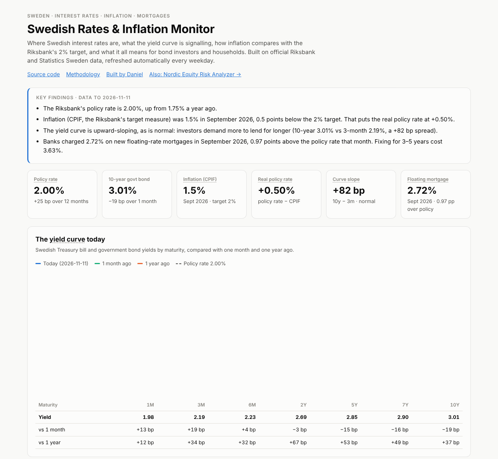
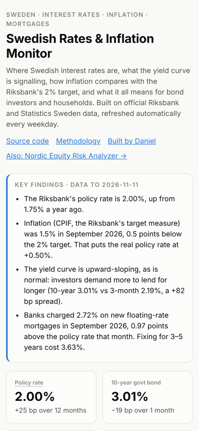

# Swedish Rates & Inflation Monitor

[](https://github.com/danielengerby1/Swedish-rates-monitor/actions/workflows/tests.yml)
[](https://github.com/danielengerby1/Swedish-rates-monitor/actions/workflows/update-data.yml)

**Where Swedish interest rates are, what the yield curve is signalling, how inflation compares with the
Riksbank's 2% target, and what it all means for bond investors and households.** Built on official Riksbank and
Statistics Sweden data, refreshed automatically every weekday.

**Live dashboard: [swedish-rates-monitor.vercel.app](https://swedish-rates-monitor.vercel.app)**

<p>
  
  
</p>

## What it shows

- **Key findings** in plain English, generated from the latest data: policy rate, inflation gap, curve shape,
  mortgage spread
- **The yield curve today** (1 month to 10 years) against one month and one year ago, with changes in basis points
- **Policy rate and government bond yields** since 2005, to see how markets price future decisions
- **Curve slope and inversions**: the 10-year minus 3-month spread, with every inversion episode since 2005
  detected automatically (2008, and Jan 2023 – Jan 2025)
- **Inflation vs the 2% target**: CPIF and CPIF excluding energy, and the real policy rate
- **From policy rate to mortgages**: banks' average new floating and 3–5-year fixed mortgage rates, and the spread
- **Bond risk calculator**: price, modified duration, convexity and DV01 for a Swedish government bond, and the
  exact price change from a rate shock against the duration and duration-plus-convexity approximations
- **What rates mean for a household**: monthly mortgage cost after the Swedish interest deduction (30% up to
  SEK 100,000 of interest a year, 21% above), and what +1 or +2 percentage points would add
- Metric names explain themselves on hover or tap; works on phones; link previews show live numbers

## Data

| Data | Source | Frequency |
|---|---|---|
| Policy rate, Treasury bills (1/3/6m), government bonds (2/5/7/10y) | Sveriges Riksbank, SWEA API | daily, since 2005 |
| CPIF and CPIF excl. energy (2020=100) | Statistics Sweden (SCB), PxWebApi 2, tables TAB6590 / TAB6593 | monthly |
| Banks' new mortgage rates (floating, 3–5y fixed) | Statistics Sweden, TAB6535 | monthly |

## How it works

```
GitHub Actions (weekday evenings)            Vercel
┌────────────────────────────────┐   commit  ┌──────────────────────────┐
│ pipeline/fetch_data.py         │ ────────▶ │ static Next.js site       │
│  • polite, rate-limited fetch  │  data/    │  reads data/rates.json    │
│  • validate ranges & freshness │  rates.   │  all analysis in browser  │
│  • write only if valid+changed │  json     │                           │
└────────────────────────────────┘           └──────────────────────────┘
```

**Why a pipeline instead of live API calls?** The Riksbank API allows only a few requests a minute without a key.
Rather than calling it on every page view, a scheduled job fetches each series once a day, waits out rate limits
(`Retry-After`), validates the result (value ranges, freshness, no empty series) and commits a new snapshot only
if it is valid and has changed. Each commit redeploys the site. Visitors never hit the APIs, the page loads
instantly, and a failed or suspicious fetch never replaces good data.

**Methodology notes**

- Series missing for a day (holidays) are carried forward for at most five days; longer gaps stay blank.
- **Curve shape** from the 10y − 3m spread: below −10 bp inverted, up to +25 bp flat, up to +150 bp normal,
  above that steep. An inversion episode needs at least 20 trading days; recoveries shorter than 10 days don't
  split one.
- **Real policy rate** = policy rate − latest CPIF annual change (a simple ex-post measure).
- **Bond maths**: annual-coupon bond valued on a coupon date; price, Macaulay and modified duration, convexity
  and DV01. The rate-shock price change is computed exactly and with both approximations, so the convexity
  effect is visible.
- **Mortgage spread** compares banks' average new-lending rate with the policy rate's average in the same month.

## Verification

- The bond maths is implemented in Python and TypeScript and tested against a shared fixture.
- The mortgage calculator is tested against Skatteverket's worked example of the interest deduction.
- The pipeline is tested for JSON-stat parsing, gap handling, validation and rate-limit retries.
- Both suites run on every push (GitHub Actions).

## Run it yourself

```bash
npm install
npm run dev                        # http://localhost:3000, uses the committed data snapshot
npm test

python pipeline/fetch_data.py      # refresh data/rates.json (standard library only)
python pipeline/fetch_data.py --check
pytest pipeline/tests
```

```
pipeline/fetch_data.py   fetch, validate and write data/rates.json (Riksbank + SCB)
pipeline/bond.py         bond maths (reference implementation)
data/rates.json          the committed data snapshot
lib/                     data helpers, insights (curve shape, inversions), bond and mortgage maths
components/              dashboard, charts, calculators, metric explanations
app/                     page and link-preview image
```

## Limitations

- Yields are the Riksbank's published benchmark yields, not a fitted zero-coupon curve.
- Mortgage rates are banks' volume-weighted averages for new lending, not any one bank's list price.
- For education and demonstration only; not financial advice.

---
Built by [Daniel Engerby](https://www.linkedin.com/in/danielengerby/) with Python, TypeScript and Claude Code.
See also: [Nordic Equity Risk Analyzer](https://github.com/danielengerby1/Nordic-Equity-Analyser).
Data: Sveriges Riksbank and Statistics Sweden.
